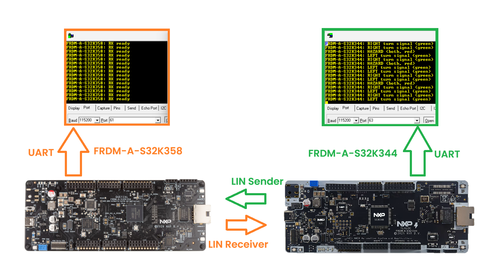
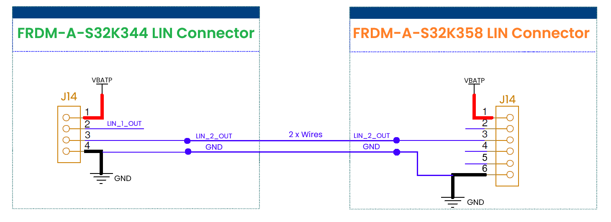
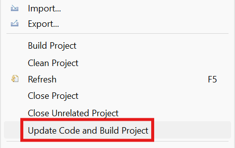
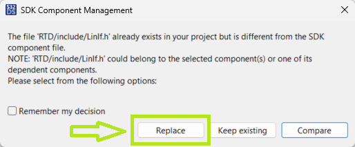
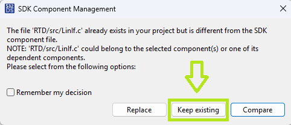
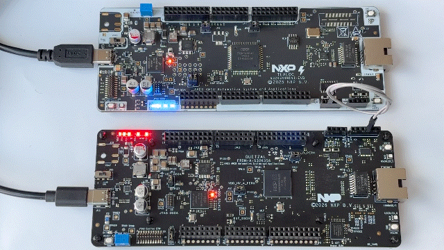

# NXP Application Code Hub
[](https://www.nxp.com)

## LIN-Based Vehicle Turn Signal Controller Using eMIOS GPT
This example showcases a vehicle-inspired turn signal application implemented on two NXP FRDM-A-S32K3 boards. The LIN Sender board monitors user button inputs and periodically transmits turn signal commands through LIN communication frames, while the LIN Receiver board receives the commands and controls LED indicators representing the vehicle lamps. The eMIOS GPT timer is used to generate a synchronized blink pattern on both nodes, allowing the turn signals to operate consistently across the LIN network. The project demonstrates how LIN signal communication and timer peripherals can be combined to implement a realistic automotive body-control function.
[<p align="center"></p>](./images/FRDM-A-S32K344-LIN-Sender-FRDM-A-S32K358-Receiver.png)

#### Boards: FRDM-A-S32K344, FRDM-A-S32K358
#### Categories: Networking
#### Peripherals: LIN, SIUL2, COUNTER, UART
#### Toolchains: S32 Design Studio IDE

## Table of Contents
1. [Software and Tools](#step1)
2. [Hardware](#step2)
3. [Setup](#step3)
4. [Results](#step4)
5. [Support](#step5)
6. [Release Notes](#step6)

## 1. Software and Tools<a name="step1"></a>
This example was developed using the FRDM Automotive Bundle for S32K3 + S32M27. To download and install the complete software and tools ecosystem, use the following links:
- [ FRDM Automotive S32K3 + S32M27 Board Installation Package](https://www.nxp.com/app-autopackagemgr/automotive-software-package-manager:AUTO-SW-PACKAGE-MANAGER?currentTab=0&selectedDevices=S32K3&applicationVersionID=203)
- Serial terminal program (for example: PuTTy, Tera Term, RealTerm etc.)

## 2. Hardware<a name="step2"></a>
### 2.1 Required Hardware
- Personal Computer
- Type-C USB cable

| Boards | Images |
| ------ | ------ |
| - [FRDM-A-S32K344](https://www.nxp.com/design/design-center/development-boards-and-designs/FRDM-A-S32K344) |  |
| - [FRDM-A-S32K358](https://www.nxp.com/design/design-center/development-boards-and-designs/FRDM-A-S32K358) |  |

### 2.2 Hardware Connections
- Connect FRDM-A-S32K358's LIN2 pin (J14-3) to FRDM-A-S32K344's LIN2 pin (J14-3)
- Connect FRDM-A-S32K358's GND  pin (J14-6) to FRDM-A-S32K344's GND  pin (J14-4)
    [<p></p>](./images/FRDM-A-S32K344_LIN_to_FRDM-A_S32K358.png)

### 2.3 Debugger Connection
- Connect the Type-C USB cable to PC and FRDM-A-S32K344 board for power supply and debugging.
- Connect the Type-C USB cable to PC and FRDM-A-S32K358 board for power supply and debugging.

## 3. Setup<a name="step3"></a>

### 3.1 Import the Project into S32 Design Studio IDE
1. Open S32 Design Studio IDE, in the Dashboard Panel, choose **Import project from Application Code Hub**.
   [<p align="center"></p>](./images/import_project_1.png)

2. You can find the demo you need by searching for the name directly
3. Open the project, click the **GitHub link** in this window, S32 Design Studio IDE will automatically retrieve project attributes, then click **Next>**.
    [<p align="center"></p>](./images/import_project_3.png)

4. Select **main** branch and then click **Next>**.

5. Select your local path for the repo in **Destination->Directory:** window. The S32 Design Studio IDE will clone the repo into this path, click **Next>**.

6. Select **Import existing Eclipse projects** then click **Next>**.

7. Select the 2 projects in the repository then click **Finish**.

### 3.2 Generating, Building and Running the Example

1. In Project Explorer, right-click on each project and select **Update Code and Build Project**. This will generate the configuration (Pins, Clocks, Peripherals), update the source code and build the project using the active configuration (e.g. Debug_FLASH).
Make sure the build completes successfully and the *.elf file is generated without errors.
[<p align="center"></p>](./images/update_and_build.png)
2. If during this process a pop-up appears asking whether or not to replace or keep the existing LIN configuration files, it's very important to select **Replace**, otherwise build issues may occur.
[<p align="center"></p>](./images/build_project_1.png)
> **Note:** With the HSE firmware package installed (e.g. `HSE_FW_S32K344_0_2_55_0_D2502`), **Replace** can cause build errors. In that case select **Keep existing** and rebuild.
[<p align="center"></p>](./images/build_project_2.png)
#### Debugging the projects
Go to **Debug** and select **Debug Configurations**. Select **GDB PEMicro Interface Debugging**:
[<p align="center"></p>](./images/DebugConfigurations.png)

Use the controls to control the program flow.

> Note: The GDB PEMicro Interface Debugging configuration uses a default ports 6224 and 7224. In example are provided 2 debug configurations, one with default ports and another one with custom ports to support debugging of 2 boards simultaneously on the same PC. In one launch configuration, select one board (for example USB1) and in the second launch configuration, select the other board (for example USB2).

## 4. Results<a name="step4"></a>
Once both boards are flashed and running, open a serial terminal (115200 8N1) on each board's console UART to monitor the demo, then press the buttons on the FRDM-A-S32K344 (LIN Sender) to control the turn signal LEDs on the FRDM-A-S32K358 (LIN Receiver):
[<p align="center"></p>](./images/FRDM-A-S32K344-LIN-Sender-FRDM-A-S32K358-Receiver-Demo.gif)

| Button pressed (Sender) | LIN command | LED behavior (Receiver) |
| :---: | :---: | :--- |
| None | `NONE` | Both LEDs off |
| SW2 | `LEFT` | LED0 blinks **green** |
| SW3 | `RIGHT` | LED1 blinks **green** |
| SW2 + SW3 | `HAZARD` | LED0 and LED1 blink **red** together |

Each turn-signal command is transmitted by the Sender over the LIN bus and is reflected on the Sender's console, for example:
```
FRDM-A-S32K344: LEFT turn signal (green)
FRDM-A-S32K344: RIGHT turn signal (green)
FRDM-A-S32K344: HAZARD (both, red)
```

On startup, the Receiver prints the following to confirm it is ready to receive LIN frames:
```
FRDM-A-S32K358: RX ready
```

The LED blink timing on the Receiver is generated by its eMIOS GPT timer, keeping the turn-signal pattern consistent and synchronized across the LIN network for as long as the corresponding button is held on the Sender.

## 5. Support<a name="step5"></a>

For general technical questions related to NXP microcontrollers, please use the [NXP Community Forum](https://community.nxp.com/).
#### Project Metadata

<!----- Boards ----->
[](https://mcuxpresso.nxp.com/appcodehub?hwBoard=FRDM-A-S32K344)
[](https://mcuxpresso.nxp.com/appcodehub?hwBoard=FRDM-A-S32K358)

<!----- Categories ----->
[](https://mcuxpresso.nxp.com/appcodehub?category=networking)

<!----- Peripherals ----->
[](https://mcuxpresso.nxp.com/appcodehub?peripheral=lin)
[](https://mcuxpresso.nxp.com/appcodehub?peripheral=siul2)
[](https://mcuxpresso.nxp.com/appcodehub?peripheral=counter)
[](https://mcuxpresso.nxp.com/appcodehub?peripheral=uart)

<!----- Toolchains ----->
[](https://mcuxpresso.nxp.com/appcodehub?toolchain=s32_design_studio_ide)

Questions regarding the content/correctness of this example can be entered as Issues within this GitHub repository.

>**Note**: For more general technical questions regarding NXP Microcontrollers and the difference in expected functionality, enter your questions on the [NXP Community Forum](https://community.nxp.com/)

[](https://www.youtube.com/NXP_Semiconductors)
[](https://www.linkedin.com/company/nxp-semiconductors)
[](https://www.facebook.com/nxpsemi/)
[](https://x.com/NXP)

## 6. Release Notes<a name="step6"></a>
| Version | Description / Update                           | Date                         |
|:-------:|------------------------------------------------|-----------------------------:|
| 1.0     | Initial release on Application Code Hub        | October 16<sup>th</sup> 2026 |
